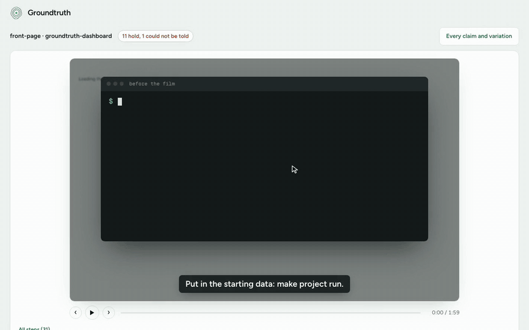

# Groundtruth

Groundtruth checks an agent's work against what you asked for.



As models get better at coding, two aspects of building get more important:
1. Knowing that your agent is building what you actually want. Ideally this is represented intuitively, like in natural language, or visually (coming soon).
2. Knowing that the product works, in a variety of situations.

Groundtruth aims to address both. Your request becomes a series of **claims** describing what the user sees in the app. Each claim has
**variations**, the situations it has to hold in. When we can't exhaustively check every possible series of inputs and outputs, variations try to capture the kinds of situation your app is likely to encounter. You read them and approve them. Then a separate verifier, which did
not write the code and is not shown it, tries every variation in your running app in a real browser, on film. Ordinary code, not the model, turns what it recorded into a result per claim.

You end up with a page per feature: which claims hold, which fail, which could not be told, and a film of each
variation that you can watch.

This is a working prototype, and a lot is still going to be added!

## Why it is built this way

- **The agent that builds does not grade itself.** The verifier is a different process with a fixed list of tools. It
  uses the app the way a person would. The sessions that try the variations are never shown the code or the diff, so
  they cannot be talked into a pass by a comment or a test.
- **You have full control over the data tools.** You hand the verifier a list of tools it can use to manipulate data, changing the starting state of the app (e.g. starting an ecommerce app with 3 items on the listing, 2 items in cart, and 1 item sold out). If the verifier realizes it needs a tool it does not have, it requests it. You can also mark an outside service your app calls as read-only, stand-in only, or off. See `DATATOOLS.md`.
- **Every result has a film behind it.** The page shows the film with one caption saying what is being tried and what
  each check found.

## How it fits together

```
 your machine                                            the verifier
 +---------------------------------------+               +-----------------------------------+
 | your app (your agent starts it)       |   claims,     | plans each variation, runs one    |
 |        ^                              |   app address | model session per variation,      |
 |        | browser, HTTP, data tools    | ------------> | checks what comes back, decides   |
 | tool server (inside `verify`)         | <-- actions - | each claim's result from a table  |
 |  a fixed tool list, films, the report | -- results -> |                                   |
 +---------------------------------------+               +-----------------------------------+
   every connection starts on the left; the verifier never reaches into your machine
```

- `groundtruth.py`: the command. `toolserver/`: the half that runs beside your app and drives the browser.
- `service/`: the verifier (the planner, the per-variation sessions, the prompts, the rules that decide results).
- `store/` and `dashboard/`: where finished runs are kept, and the pages that show them.
- `skills/`: the instructions that teach Claude Code or GitHub Copilot to use it.
- `gates/`: scripted checks on the verifier itself, with their results.

## Try it

You need macOS or Linux, Python 3.12 or newer, [Claude Code](https://claude.com/claude-code) installed and signed in
(the verifier runs its model sessions through `claude -p`; set `GT_CLAUDE` if it is not at `~/.local/bin/claude`), and
an app of yours running at a local address with data that is safe to change.

... or just point your agent to this repo and ask it to set it up!

```bash
./scripts/install.sh
```

```bash
bin/groundtruth up
```

`up` starts the verifier and the results pages on your machine (ports 8790 and 8900). Then, from your project's
folder, give your coding agent the skill:

```bash
/path/to/bin/groundtruth install-skills .
```

Add `--agent copilot` for GitHub Copilot. Now ask your agent for a change and say "use groundtruth to verify it". It
drafts claims from your words, shows them to you, approves them when you say they are right, builds, and runs the
verifier.

The same steps by hand, from your project's folder:

```bash
groundtruth draft --said my-request.txt     # claims from what you asked for
groundtruth claims                           # read them
groundtruth approve                          # record that they are right
groundtruth connect http://localhost:3000    # the app you started
groundtruth verify --walkthrough             # try every variation, on film
groundtruth results                          # each claim's latest result
```

`verify` prints the address of the feature's page.

To look at the pages without running anything, serve the finished runs kept in `dashboard/samples/` and open
http://127.0.0.1:8911:

```bash
.venv/bin/python dashboard/dev_server.py
```

A variation is one model session, roughly 10 to 15 cents each on the default model. A feature with two claims, eight
variations and a walkthrough film came to about one dollar.

## How the verifier itself is checked

A verifier that passes everything is worthless, so it is tested against apps with bugs planted in them, and against
clean copies where it must not raise a false alarm. Each check is a script (`gates/props_gate.py`), each result is in
`gates/results/`, and a check that fails is left failing, not tuned until it passes.

| Check | What it runs on | Result |
|---|---|---|
| `cbay` | a sample shop, cart rules | 181 of 181 |
| `qtycap` | the shop with a bug planted in adding the same item twice | 19 of 19 |
| `twodoors` | the same action reachable two ways, one broken | 43 of 45 |
| `unseen` | two variants the verifier had not seen, scored against a sealed key | 177 of 177 |
| `ways` | four sealed copies, scoring how each way in was found | 112 of 118 |
| `lipsync` | a small animation demo with a planted bug | 131 of 131 |
| `claimsclean` | the dashboard's own claims on a clean copy | 79 of 79 |
| `claimsbugs` | the same claims on three copies with planted bugs | 85 of 85 |
| `data` | variations that need data made by a data tool | 91 of 93 |

The first six were rerun on this code on 2026-11-15. The last three are from when that part was built and have not
been rerun since. The sample shop and the sealed copies are not in this repository, so the scripts are here to read,
not to run as they are.

## Known weaknesses

- **False questions.** The planner sometimes plans a variation outside what the claim says (a sold-out item for a
  claim about items in stock) and then asks whether the result is intended. That is the two failures in `twodoors`; no
  planted bug was missed because of it. It also tends to overfixate on specific examples you provide, rather than generalizing. These are quirks that can be somewhat alleviated by prompting.
- **Parts of a page it cannot see.** Colours, hover states and timing are checked only where a tool can measure them.
  What was not checked is listed on the page. The verifier's toolset will be expanded to include these.
- **The app has to run on your machine.** Checking a deployed preview is not supported yet.
- **Checks that measure a process** (memory, GPU) work on macOS only.

## More

- `DATATOOLS.md`: how a project declares the small commands that set up data for a variation.
- `RUNDOC.md`: the document a finished run is stored as.
- `docs/older-code-search-path.md`: the earlier design, where the verifier searched the code for every way in.

## Licence

Copyright (C) 2026 Keyon Jazayeri.

Groundtruth is free software under the [GNU Affero General Public License, version 3](LICENSE). You can run it, read
it and change it. If you run a changed version as a service for other people, you have to make your changes available
to them under the same licence.
